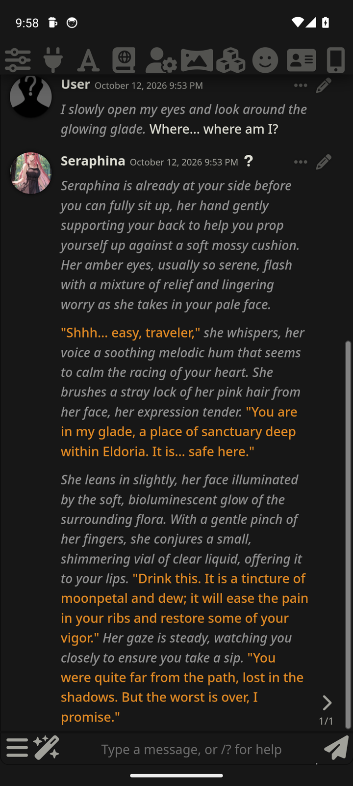
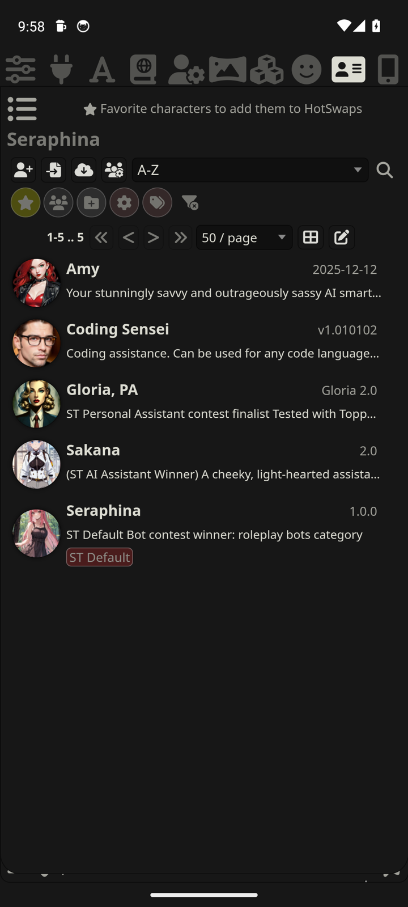
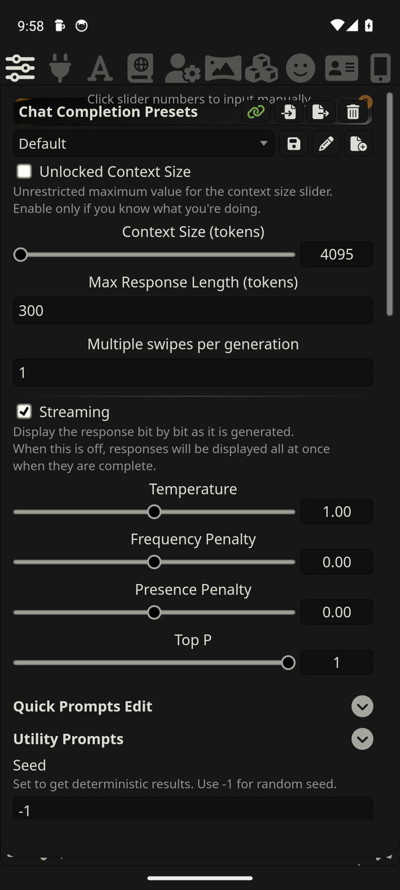
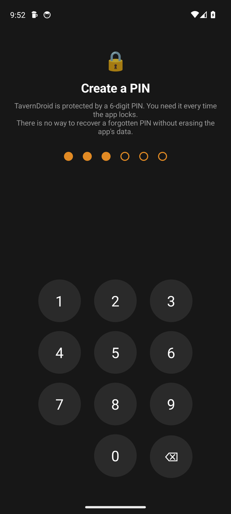
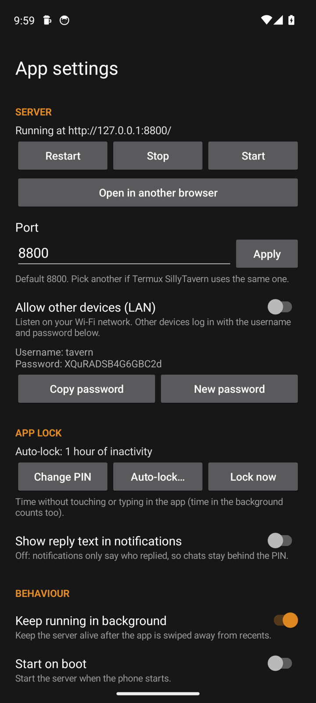
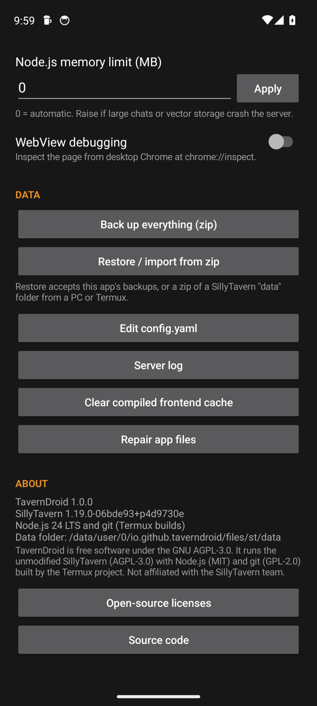

<div align="center">


# TavernDroid

### The full SillyTavern, as a real Android app

No Termux. No PC. No command line. Install the APK, set a PIN, and chat.

[](LICENSE)


&nbsp;
&nbsp;


&nbsp;
&nbsp;


</div>

---

## Why TavernDroid?

Running SillyTavern on a phone used to mean Termux, `git clone`, `npm install`, and a browser tab that dies
when Android gets hungry. **TavernDroid packs the real thing into one app.** It ships the *actual*
SillyTavern server (plus small, upstreamable [bug fixes](patches/README.md)) with its own Node.js runtime, starts it in the background, and shows the full interface
full-screen. You get **every** SillyTavern feature, because it *is* SillyTavern.

| | Termux + browser | **TavernDroid** |
|---|:---:|:---:|
| Setup | ~15 commands | **Install the APK** |
| Every SillyTavern feature and extension | ✅ | ✅ |
| Survives the screen turning off mid-reply | ⚠️ often not | ✅ foreground service + wake lock |
| Notification when a reply arrives | ❌ | ✅ |
| Exports land in Downloads, imports via the file picker | ⚠️ | ✅ |
| Back button closes panels instead of leaving | ❌ | ✅ |
| System TTS voices | ❌ (WebView lacks Web Speech) | ✅ Android TextToSpeech |
| PIN lock with auto-lock | ❌ | ✅ |
| One-tap full backup, and Termux migration | ❌ | ✅ |

## Features

**All of SillyTavern 1.19**
- Every API: OpenRouter, OpenAI, Claude, Gemini, DeepSeek, Mistral, Groq, xAI, NovelAI, AI Horde, and your own
  **llama.cpp / KoboldCpp / Ollama / vLLM / TabbyAPI** server on the PC or LAN
- Characters (PNG, JSON, CharX, BYAF), group chats, personas, swipes, branches, checkpoints
- World Info / lorebooks, Author's Note, Prompt Manager, instruct and context templates, reasoning models
- STscript and Quick Replies, Regex, Summarize, Vector Storage with on-device embeddings, Data Bank
- Image generation, captioning, translation, expressions, TTS (all providers), themes and custom CSS
- Third-party extensions install and update through the **bundled git**

**Made for phones**
- 🔐 **App lock**: 6-digit PIN created on first launch, auto-lock after inactivity (default 5 min, from "immediately" to 1 h), rate-limited attempts
- 🔋 Replies keep generating with the screen off; you get a **notification** when one arrives
- 📥 Exports go to `Downloads/SillyTavern`; imports use the system file picker
- ◀️ The **Back** button closes SillyTavern's panels and popups first
- 🗣️ **System TTS** speaks with the voices installed on the phone
- 📶 **LAN mode**: use the phone as a SillyTavern server for your other devices (password-protected)
- 💾 **One-tap backup and restore**, which also imports a `data` folder zipped from a PC or **Termux** install
- 🧾 Server log viewer (password recovery codes) and a `config.yaml` editor for every server option
- 🧠 Tokenizers bundled, so token counting works offline from the first launch

## Install

1. Download `TavernDroid-<version>.apk` from **[Releases](../../releases)**.
2. Open it on your phone and allow installing from this source.
3. Launch **TavernDroid**, create your PIN, and wait about 15 s on the first start.
4. Open the 🔌 **API Connections** panel and connect your AI (OpenRouter, a PC running llama.cpp, …).

> **Requirements:** Android 7.0+ · 64-bit ARM (almost every phone since 2017) · ~600 MB free storage

### Moving from SillyTavern in Termux

Zip your `SillyTavern/data` folder, then in TavernDroid open the 📱 icon (top-right) → **Restore / import from zip**.
Characters, chats, presets, lorebooks, settings and API keys come across.

## How it works

```
┌──────────── TavernDroid (Kotlin) ────────────┐
│  WebView  ⇄  http://127.0.0.1:8800           │
│     ▲ native bridge: files, back key, TTS,   │
│     │ notifications, PIN lock                │
│  Foreground service → Node.js 24 → SillyTavern server → your AI APIs
└──────────────────────────────────────────────┘
```

SillyTavern's server has **no native code** (everything heavy is JavaScript or WASM), so an Android build of
Node.js runs it unchanged. TavernDroid bundles Termux's Node.js 24 and git, adapts them to run inside a normal
app (no root, no Termux), and adds a thin native layer for everything a browser tab cannot do.
Read **[docs/ARCHITECTURE.md](docs/ARCHITECTURE.md)** for the details, and
**[docs/research/](docs/research/)** for a reverse-engineered map of SillyTavern itself: every server route,
the generation pipeline, all 293 slash commands, and every UI control.

## Tested

An end-to-end suite ([`tools/e2e`](tools/e2e), 89 tests) drives the **real release APK** through Chrome DevTools
and adb: every generation mode, Chat/Text Completion, OpenRouter, all 19 tokenizers, character and chat
management, imports and exports, World Info, groups, presets, on-device embeddings, classification and captioning,
image generation, TTS, translation, git extensions, backup and restore, LAN mode, PIN lock, rotation, renderer and
server crash recovery, port conflicts and start-on-boot. It found and fixed six bugs, including two in SillyTavern
itself. See **[docs/FEATURE_PARITY.md](docs/FEATURE_PARITY.md)** for the full results.

> **Tip for low-RAM phones:** local captioning, embeddings and classification run on the phone. On devices with
> 4 GB RAM or less, use a remote provider for captioning. If memory runs out, the server restarts itself.

## Build it yourself

```bash
chmod +x gradlew tools/*.sh tools/e2e/*.sh         # only needed if the repo was uploaded through the GitHub website
tools/fetch_termux.sh                              # Termux Node.js LTS + git packages (SHA-256 verified)
ST_SRC=/path/to/SillyTavern tools/prepare.sh       # a SillyTavern checkout with `npm install` done
./gradlew assembleRelease
```

`prepare.sh` exports the checkout, applies the bug fixes in [`patches/`](patches/), prunes dev dependencies,
bundles everything into the APK and turns the Termux binaries into loadable `lib*.so` files.
Release signing reads `keystore.properties` (`storeFile`, `storePassword`, `keyAlias`, `keyPassword`).

## License and credits

TavernDroid is free software under the **[GNU AGPL-3.0](LICENSE)**.

It bundles **[SillyTavern](https://github.com/SillyTavern/SillyTavern)** (AGPL-3.0) and Node.js (MIT), git (GPL-2.0),
OpenSSL, ICU, curl, SQLite and zlib as built by the **[Termux](https://github.com/termux/termux-packages)**
project. Their licenses are in the app under *Settings → Open-source licenses*, and exact package versions are in
[`runtime/termux-packages.tsv`](runtime/termux-packages.tsv).

TavernDroid is an independent project and is **not affiliated with or endorsed by the SillyTavern team**.
All credit for SillyTavern goes to its developers and community.
